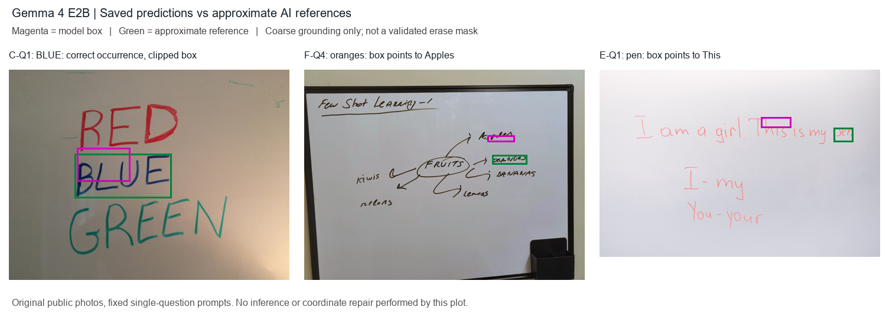

# 非中國發布機構候選：本機測試結果（2026-10-30）

**本輪四條備案中，Gemma 4 E2B 最值得保留：內容／粗定位 8/18、格式 18/18。** Qwen3-VL GPU 對照為 10/18、格式 17/18。其餘備案在這套繁中單題提示下表現不足；結果不支持直接拿模型框控制擦除，也還不足以判定需要自行訓練。

實際完成同三張照片 × 18 題 × 六路，共 **108 個原始答案**；不訓練、不接手臂、不使用外部推論 API。這是 AI 近似參考＋獨立 AI 複核的診斷回歸集，尚非人工接受或泛化證據。

## 同題結果

「內容」要求選對全部 occurrence、status 與粗位置；不含 JSON 格式，也不是精準擦除遮罩。格式錯誤仍留在分母，原文不修補。三類各六題。

| 路線 | 文字／顏色 | 相對位置 | 語意條件 | 內容合計 | 格式合格 | 內容且格式合格 |
| --- | ---: | ---: | ---: | ---: | ---: | ---: |
| Qwen3-VL-2B（GPU 對照） | 5/6 | 3/6 | 2/6 | 10/18 | 17/18 | 10/18 |
| Gemma 4 E2B | 5/6 | 2/6 | 1/6 | 8/18 | 18/18 | 8/18 |
| RapidOCR＋Qwen2.5-1.5B | 3/6 | 0/6 | 1/6 | 4/18 | 0/18 | 0/18 |
| Phi-4-multimodal | 0/6 | 0/6 | 1/6 | 1/18 | 0/18 | 0/18 |
| SmolVLM2-2.2B | 0/6 | 0/6 | 0/6 | 0/18 | 1/18 | 0/18 |
| docTR＋SmolLM2-1.7B | 0/6 | 0/6 | 0/6 | 0/18 | 0/18 | 0/18 |

## 觀察與判斷

- **Gemma：** 單看文字／集合／status 有 10/18，但 F-Q4 說 oranges 卻框到 Apples、E-Q1 說 pen 卻框到 This，因此主指標降為 8/18。C-Q1／Q4 的 BLUE 與 C-Q5 的 GREEN 也有明顯裁切；沿用原先「粗位置」規格仍計入正確，沒有事後新增覆蓋率門檻，但這些框不能稱為可用擦除範圍。
- **語意條件仍弱：** Gemma 1/6、Qwen VLM 2/6。常見錯誤是把「保留」的詞反選、漏掉重複的 my/I，或沒有遵守 no_match。
- **docTR＋SmolLM2：** OCR 把 RED／GREEN 拆成零碎筆畫，且漏掉英文圖的兩個 I；文字模型又多數全選候選、所有題號都照抄 question id。這條 pipeline 同時改了 OCR 與 LLM，不能把失敗全歸因於其中一個。
- **SmolVLM2：** 多數回答抄題目或直接描述圖片；唯一格式合格的 E-Q3 也選錯整句。F-Q1 能說出 Lemons，但回範例般的左上框，沒有正確定位。
- **Phi：** 只有 C-Q6 的 no_match 內容正確；格式全數失敗。三題反覆輸出直到 3072 token 上限；其他題也出現錯誤 0–1 座標、選整句或抄題目。這是指定 Windows/BF16/eager 環境的結果，不代表所有 runtime 或語言提示下均相同。
- **Qwen GPU 控制：** OCR＋文字模型仍 4/18，但格式由舊 CPU 1/18 變 0/18；VLM 由舊 CPU 11/18 變 10/18，格式由 18/18 變 17/18。36 個 rendered chat 與舊 CPU 相同；裝置、dtype、Transformers 版本及程序生命週期不同，不能稱單一變因因果結果。

圖中紫框為實際模型輸出、綠框為近似 AI 參考。左圖只是粗位置吻合，另外兩圖確實指到別的單字。原圖與原答案未改寫。

## 這台電腦的實測耗時

下表為模型一次載入後依序處理 18 個獨立 context；generation 不含模型載入／影像前處理。程序總牆鐘還含 import、載入、紀錄等成本，不能直接對比舊的每題重啟 CPU 測量。不是 Thor、量化部署或跨裝置 benchmark。

| 路線 | 載入秒 | 18題生成合計秒 | 單題生成中位秒 | 模型程序總秒 | PyTorch 峰值配置 GiB |
| --- | ---: | ---: | ---: | ---: | ---: |
| Qwen3-VL-2B（GPU 對照） | 5.73 | 586.33 | 37.73 | 604.11 | 4.35 |
| Gemma 4 E2B | 14.64 | 58.36 | 2.74 | 86.20 | 10.06 |
| RapidOCR＋Qwen2.5-1.5B | 3.06 | 17.78 | 0.61 | 33.08 | 3.06 |
| Phi-4-multimodal | 28.97 | 915.04 | 4.35 | 966.73 | 17.07 |
| SmolVLM2-2.2B | 5.53 | 25.64 | 1.44 | 51.23 | 4.66 |
| docTR＋SmolLM2-1.7B | 3.66 | 37.09 | 2.16 | 55.14 | 3.57 |

docTR 另有三張圖的 CPU OCR 1.148／1.069／1.049 秒，共約 3.27 秒；其一次初始化含權重下載 9.175 秒。上表 docTR 路線的模型程序是 selector 部分；加上共用 OCR 成本約 58.41 秒（另計初始化），不是每題都重新 OCR 的端到端測量。RapidOCR 候選沿用舊資料，本輪未重跑 OCR。峰值是單一 PyTorch 程序配置量，不是整張顯卡占用量。

主 run 1759.44 秒，SmolVLM 修復重試 51.23 秒，從主 run 開始至重試結束約 30 分 12 秒，低於既定 90 分鐘。六路 108/108 有答案；105 題 EOS，Phi 的 F-Q5／E-Q2／E-Q6 三題達 token cap，沒有時間上限或未執行題。

## 逐題原始答案

每格的對／錯指內容與粗定位，不代表 schema。C／F／E 是色字／水果／英文圖；問題、判定理由與結果 hash 在 [adjudication.ai.json](adjudication.ai.json)，人工式 AI 複核筆記在 [review-notes.json](review-notes.json)。

| 題目 | Qwen VLM | Gemma | Qwen OCR＋LLM | Phi | SmolVLM | docTR＋SmolLM |
| --- | --- | --- | --- | --- | --- | --- |
| C-Q1 | [對](calls/qwen_vlm/C-Q1/raw.txt) | [對](calls/gemma/C-Q1/raw.txt) | [錯](calls/qwen_llm/C-Q1/raw.txt) | [錯](calls/phi/C-Q1/raw.txt) | [錯](calls/smolvlm/C-Q1/raw.txt) | [錯](calls/doctr_smollm/C-Q1/raw.txt) |
| C-Q2 | [對](calls/qwen_vlm/C-Q2/raw.txt) | [對](calls/gemma/C-Q2/raw.txt) | [對](calls/qwen_llm/C-Q2/raw.txt) | [錯](calls/phi/C-Q2/raw.txt) | [錯](calls/smolvlm/C-Q2/raw.txt) | [錯](calls/doctr_smollm/C-Q2/raw.txt) |
| C-Q3 | [對](calls/qwen_vlm/C-Q3/raw.txt) | [對](calls/gemma/C-Q3/raw.txt) | [錯](calls/qwen_llm/C-Q3/raw.txt) | [錯](calls/phi/C-Q3/raw.txt) | [錯](calls/smolvlm/C-Q3/raw.txt) | [錯](calls/doctr_smollm/C-Q3/raw.txt) |
| C-Q4 | [對](calls/qwen_vlm/C-Q4/raw.txt) | [對](calls/gemma/C-Q4/raw.txt) | [錯](calls/qwen_llm/C-Q4/raw.txt) | [錯](calls/phi/C-Q4/raw.txt) | [錯](calls/smolvlm/C-Q4/raw.txt) | [錯](calls/doctr_smollm/C-Q4/raw.txt) |
| C-Q5 | [對](calls/qwen_vlm/C-Q5/raw.txt) | [對](calls/gemma/C-Q5/raw.txt) | [錯](calls/qwen_llm/C-Q5/raw.txt) | [錯](calls/phi/C-Q5/raw.txt) | [錯](calls/smolvlm/C-Q5/raw.txt) | [錯](calls/doctr_smollm/C-Q5/raw.txt) |
| C-Q6 | [錯](calls/qwen_vlm/C-Q6/raw.txt) | [錯](calls/gemma/C-Q6/raw.txt) | [對](calls/qwen_llm/C-Q6/raw.txt) | [對](calls/phi/C-Q6/raw.txt) | [錯](calls/smolvlm/C-Q6/raw.txt) | [錯](calls/doctr_smollm/C-Q6/raw.txt) |
| F-Q1 | [對](calls/qwen_vlm/F-Q1/raw.txt) | [對](calls/gemma/F-Q1/raw.txt) | [錯](calls/qwen_llm/F-Q1/raw.txt) | [錯](calls/phi/F-Q1/raw.txt) | [錯](calls/smolvlm/F-Q1/raw.txt) | [錯](calls/doctr_smollm/F-Q1/raw.txt) |
| F-Q2 | [對](calls/qwen_vlm/F-Q2/raw.txt) | [對](calls/gemma/F-Q2/raw.txt) | [對](calls/qwen_llm/F-Q2/raw.txt) | [錯](calls/phi/F-Q2/raw.txt) | [錯](calls/smolvlm/F-Q2/raw.txt) | [錯](calls/doctr_smollm/F-Q2/raw.txt) |
| F-Q3 | [錯](calls/qwen_vlm/F-Q3/raw.txt) | [錯](calls/gemma/F-Q3/raw.txt) | [錯](calls/qwen_llm/F-Q3/raw.txt) | [錯](calls/phi/F-Q3/raw.txt) | [錯](calls/smolvlm/F-Q3/raw.txt) | [錯](calls/doctr_smollm/F-Q3/raw.txt) |
| F-Q4 | [對](calls/qwen_vlm/F-Q4/raw.txt) | [錯](calls/gemma/F-Q4/raw.txt) | [錯](calls/qwen_llm/F-Q4/raw.txt) | [錯](calls/phi/F-Q4/raw.txt) | [錯](calls/smolvlm/F-Q4/raw.txt) | [錯](calls/doctr_smollm/F-Q4/raw.txt) |
| F-Q5 | [錯](calls/qwen_vlm/F-Q5/raw.txt) | [錯](calls/gemma/F-Q5/raw.txt) | [錯](calls/qwen_llm/F-Q5/raw.txt) | [錯](calls/phi/F-Q5/raw.txt) | [錯](calls/smolvlm/F-Q5/raw.txt) | [錯](calls/doctr_smollm/F-Q5/raw.txt) |
| F-Q6 | [錯](calls/qwen_vlm/F-Q6/raw.txt) | [錯](calls/gemma/F-Q6/raw.txt) | [錯](calls/qwen_llm/F-Q6/raw.txt) | [錯](calls/phi/F-Q6/raw.txt) | [錯](calls/smolvlm/F-Q6/raw.txt) | [錯](calls/doctr_smollm/F-Q6/raw.txt) |
| E-Q1 | [對](calls/qwen_vlm/E-Q1/raw.txt) | [錯](calls/gemma/E-Q1/raw.txt) | [錯](calls/qwen_llm/E-Q1/raw.txt) | [錯](calls/phi/E-Q1/raw.txt) | [錯](calls/smolvlm/E-Q1/raw.txt) | [錯](calls/doctr_smollm/E-Q1/raw.txt) |
| E-Q2 | [錯](calls/qwen_vlm/E-Q2/raw.txt) | [對](calls/gemma/E-Q2/raw.txt) | [對](calls/qwen_llm/E-Q2/raw.txt) | [錯](calls/phi/E-Q2/raw.txt) | [錯](calls/smolvlm/E-Q2/raw.txt) | [錯](calls/doctr_smollm/E-Q2/raw.txt) |
| E-Q3 | [錯](calls/qwen_vlm/E-Q3/raw.txt) | [錯](calls/gemma/E-Q3/raw.txt) | [錯](calls/qwen_llm/E-Q3/raw.txt) | [錯](calls/phi/E-Q3/raw.txt) | [錯](calls/smolvlm/E-Q3/raw.txt) | [錯](calls/doctr_smollm/E-Q3/raw.txt) |
| E-Q4 | [錯](calls/qwen_vlm/E-Q4/raw.txt) | [錯](calls/gemma/E-Q4/raw.txt) | [錯](calls/qwen_llm/E-Q4/raw.txt) | [錯](calls/phi/E-Q4/raw.txt) | [錯](calls/smolvlm/E-Q4/raw.txt) | [錯](calls/doctr_smollm/E-Q4/raw.txt) |
| E-Q5 | [對](calls/qwen_vlm/E-Q5/raw.txt) | [錯](calls/gemma/E-Q5/raw.txt) | [錯](calls/qwen_llm/E-Q5/raw.txt) | [錯](calls/phi/E-Q5/raw.txt) | [錯](calls/smolvlm/E-Q5/raw.txt) | [錯](calls/doctr_smollm/E-Q5/raw.txt) |
| E-Q6 | [錯](calls/qwen_vlm/E-Q6/raw.txt) | [錯](calls/gemma/E-Q6/raw.txt) | [錯](calls/qwen_llm/E-Q6/raw.txt) | [錯](calls/phi/E-Q6/raw.txt) | [錯](calls/smolvlm/E-Q6/raw.txt) | [錯](calls/doctr_smollm/E-Q6/raw.txt) |

## 已完成驗證與限制

- 原實驗的 `analyze.py` 歷史驗證通過 108 答案原 parser 重播、prompt／image／result hash、設定與 36 個舊 Qwen chat 比對。它加總既有 AI 判定，不假稱程式重新看圖評分。
- 舊原始實驗 395 檔、3,041,240 bytes，tree SHA 仍為 `c6993c45cb34785a878ee42768740fa9eafebc072af428d22ab4dee1a8269ac6`；舊公開包 120 檔驗證亦通過。舊 CPU 環境仍為 Torch 2.9.1+cpu、Transformers 4.57.3、RapidOCR 3.4.2。
- SmolVLM 首次在產生答案前缺 num2words；核對後補 num2words 0.5.14 並修正 checkpoint 對應的類別，保留初版程式與失敗日誌，只重試一次；沒有針對低分換提示或修 JSON。
- 發布機構不同不等於全部資料／教師來源都排除中國來源。SmolVLM2 的官方訓練表仍有 Qwen 合成資料；尚無具體競賽禁令，這輪沒有資格認證。
- 上述驗證與 Git 狀態是 2026-10-30 的實驗收據；公開封存於 2026-11-02 另行整理，提交／合併／推送狀態由本次交付另報，不能沿用舊收據判定。

若延續研究，優先保留 Gemma，將「理解指令選取文字」與「可靠字框／筆畫定位」拆開檢查，再以新的照片與人工標註評估。這只是下一輪建議，尚未實作、訓練或啟動手臂。

完整執行口徑：[METHOD.md](METHOD.md)；機器可讀加總：[results.json](results.json)；原始設定：[執行收據](receipts/execution.json)；模型 revision/資產 hash：[模型資產收據](config/model-assets.json)。

本公開包是具來源 SHA 與轉換說明的可攜封存；執行 `python -I -S -B verify.py` 可離線重播 parser 與既有 AI 判定加總。36 個舊 CPU chat 相等及舊私有 tree 只保留歷史收據，本入口不再存取私有舊樹。原 review 理由已有 U+FFFD 編碼損失，本次原樣保留，沒有補寫或重新判題。辨識研究於本次封存後暫停。
