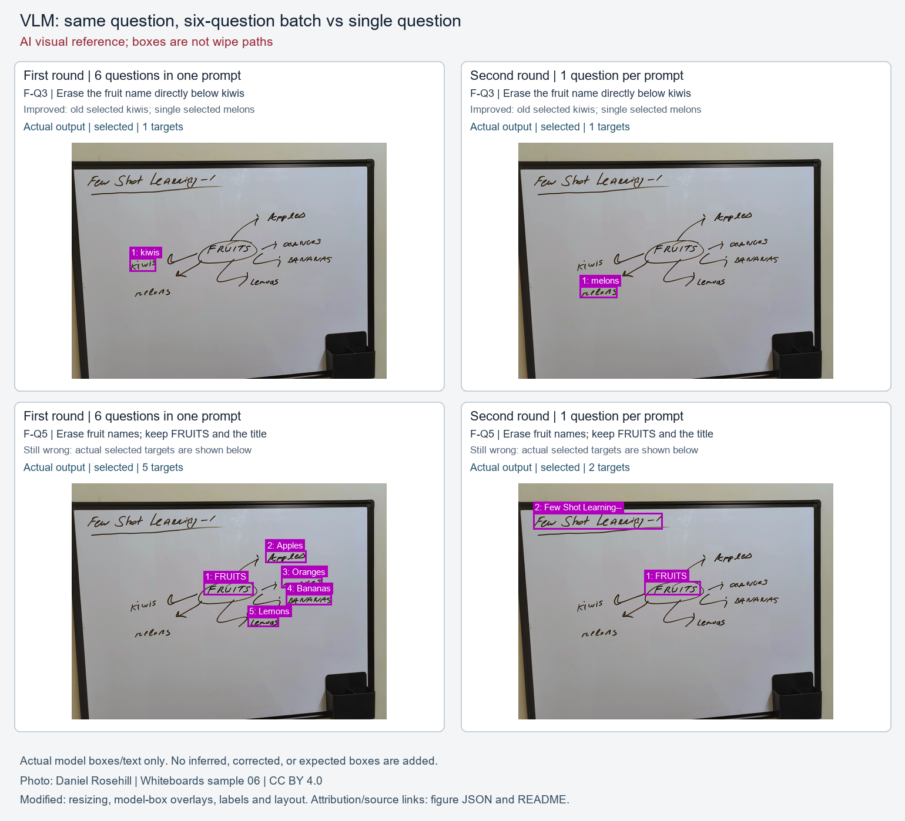

# 單題控制實驗結果：同三張照片、同 18 題

**拆題改變回答，但改善有限，不能把原錯誤都歸因於一起問。** 原始回答內容的 AI 目視核對，A 由 4/18 維持 4/18，B 由 10/18 變為 11/18；兩路都出現改對與退步。這不證明單題能穩定消除錯誤，也不能推論模型或架構的普遍優劣。

以下是 **AI 近似參考＋獨立 AI 逐題複核，尚非人工接受的 ground truth**。核對的是目標出現次數、完整選取集合／狀態及粗略位置；不是精準擦除遮罩、擦拭安全或實機成功。全程沒有訓練或接入手臂。

## 同題內容比較

| 原始回答內容的 AI 目視核對 | A 首輪 | A 單題 | B 首輪 | B 單題 |
| --- | ---: | ---: | ---: | ---: |
| 全部 18 題 | 4/18 | 4/18 | 10/18 | 11/18 |
| 文字／顏色 | 3/6 | 3/6 | 6/6 | 5/6 |
| 相對位置 | 0/6 | 0/6 | 3/6 | 4/6 |
| 語意 | 1/6 | 1/6 | 1/6 | 2/6 |

| 路徑 | 改對（完整清單） | 退步（完整清單） | 淨增加正確題數 |
| --- | --- | --- | ---: |
| A：OCR＋小型 LLM | C-Q6、E-Q2 | C-Q1、C-Q5 | +0 |
| B：VLM | F-Q3、F-Q4、E-Q5 | E-Q2、E-Q4 | +1 |

所有 18 題都留在分母；格式錯誤的原始內容只作診斷閱讀，沒有修補成可用輸出。統計直接由 [逐題 adjudication](annotations/single-adjudication.ai.json) 與 [前後比較資料](annotations/comparison.json) 產生。

- **A 改對 C-Q6、E-Q2：** 這兩張圖分別沒有水果名稱／藍字，單題回覆內容改為 `no_match`。但原本答對的 BLUE（C-Q1）與全部顏色詞（C-Q5）也變成 `no_match`，因此淨改善為零。固定 OCR 的 `Lemons→lervas` 等缺口沒有消失；候選已有 `pen`、中間 `my`，選取器仍會漏選，問題不只在 OCR。
- **B 改對三題：** F-Q3 從 kiwis 自身改成其下方 melons；F-Q4 從 FRUITS 改成介於 Apples／BANANAS 之間的 ORANGES；E-Q5 終於選齊上方 I、中間 I 與下方 You 的三次出現。
- **B 也退步兩題：** E-Q2 原本正確回 `no_match`，拆題後卻選了三整列文字，雖然圖中沒有藍字；E-Q4 原本選對中間對照列的 my，這次改選上方例句的 pen。
- **B 持續失敗的五題：** C-Q6 沒有水果仍選顏色詞；F-Q5 只選應保留的 FRUITS＋標題；F-Q6 仍只選唯一要保留的標題；E-Q3 要最下方左側 You，卻列出全圖 12 個單字；E-Q6 仍漏掉上方例句的 my。保留／擦除語意與重複出現的完整性，沒有因拆題一併解決。

圖示 F-Q3 改對與 F-Q5 持續錯誤，只畫實際模型框與原字串，不新增／修正選框。圖已由 主責 AI 目視核對與 raw 一致，仍不是人工驗收或擦拭路徑。[圖像證據 JSON](assets/figures/provenance.json) 保留各 raw／result hash；作者 **Daniel Rosehill**、來源與 **CC BY 4.0** 及縮小／覆框／排版改動說明見 [圖像 README](ATTRIBUTION.md) 和 [原始來源紀錄](sources.json)。

## 格式契約另計

| 既有解析器契約 | A | B |
| --- | ---: | ---: |
| 首輪：每次同圖六題 | 1/3 個 batch | 3/3 個 batch |
| 單題：每次一題 | 1/18 個呼叫 | 18/18 個呼叫 |

兩列的測量單位不同，不能直接解讀成同單位改善百分點。原解析器本來就允許移除完整 JSON code fence；B 的契約通過不表示所有 raw 都是純 JSON。A 只有 C-Q2 通過，其餘 **17 題尾端多出的引號沒有修補**。若同時要求內容符合且該次呼叫契約通過，本輪 A 為 1/18、B 為 11/18；這仍不等於可部署或擦除成功。

## 18 題逐題檢視

「對／錯」只表示原始回答內容的 AI 參考核對，不含格式契約。每格連到該路徑的本輪原始回答；首輪原文與判定在 [首輪結果](README.md) 和 [首輪 adjudication](annotations/batch-adjudication.ai.json)。C／F／E 分別為色字／水果／英文照片。

| 題號 | 類型 | 原始指令（不改寫） | A 首輪→單題 | B 首輪→單題 |
| --- | --- | --- | --- | --- |
| C-Q1 | 文字／顏色 | 只擦掉文字 BLUE。 | [對→錯](calls/single/ocr_llm/C-Q1/raw.txt) | [對→對](calls/single/vlm/C-Q1/raw.txt) |
| C-Q2 | 文字／顏色 | 只擦掉紅色墨水寫成的完整英文單字。 | [對→對](calls/single/ocr_llm/C-Q2/raw.txt) | [對→對](calls/single/vlm/C-Q2/raw.txt) |
| C-Q3 | 相對位置 | 擦掉最下方的完整英文單字。 | [錯→錯](calls/single/ocr_llm/C-Q3/raw.txt) | [對→對](calls/single/vlm/C-Q3/raw.txt) |
| C-Q4 | 相對位置 | 擦掉位於 RED 與 GREEN 之間的單字。 | [錯→錯](calls/single/ocr_llm/C-Q4/raw.txt) | [對→對](calls/single/vlm/C-Q4/raw.txt) |
| C-Q5 | 語意 | 擦掉所有表示顏色名稱的英文單字。 | [對→錯](calls/single/ocr_llm/C-Q5/raw.txt) | [對→對](calls/single/vlm/C-Q5/raw.txt) |
| C-Q6 | 語意 | 擦掉表示水果名稱的英文單字。 | [錯→對](calls/single/ocr_llm/C-Q6/raw.txt) | [錯→錯](calls/single/vlm/C-Q6/raw.txt) |
| F-Q1 | 文字／顏色 | 只擦掉文字 Lemons。 | [錯→錯](calls/single/ocr_llm/F-Q1/raw.txt) | [對→對](calls/single/vlm/F-Q1/raw.txt) |
| F-Q2 | 文字／顏色 | 擦掉所有藍色墨水寫成的英文文字。 | [對→對](calls/single/ocr_llm/F-Q2/raw.txt) | [對→對](calls/single/vlm/F-Q2/raw.txt) |
| F-Q3 | 相對位置 | 擦掉位於 kiwis 正下方的水果名稱。 | [錯→錯](calls/single/ocr_llm/F-Q3/raw.txt) | [錯→對](calls/single/vlm/F-Q3/raw.txt) |
| F-Q4 | 相對位置 | 擦掉 FRUITS 右側、介於 Apples 與 BANANAS 之間的水果名稱。 | [錯→錯](calls/single/ocr_llm/F-Q4/raw.txt) | [錯→對](calls/single/vlm/F-Q4/raw.txt) |
| F-Q5 | 語意 | 擦掉所有具體水果種類的名稱，保留類別名稱 FRUITS 與課程標題。 | [錯→錯](calls/single/ocr_llm/F-Q5/raw.txt) | [錯→錯](calls/single/vlm/F-Q5/raw.txt) |
| F-Q6 | 語意 | 只保留最上方帶底線的課程標題，擦掉其餘所有英文文字。 | [錯→錯](calls/single/ocr_llm/F-Q6/raw.txt) | [錯→錯](calls/single/vlm/F-Q6/raw.txt) |
| E-Q1 | 文字／顏色 | 只擦掉文字 pen。 | [錯→錯](calls/single/ocr_llm/E-Q1/raw.txt) | [對→對](calls/single/vlm/E-Q1/raw.txt) |
| E-Q2 | 文字／顏色 | 擦掉所有藍色墨水寫成的英文文字。 | [錯→對](calls/single/ocr_llm/E-Q2/raw.txt) | [對→錯](calls/single/vlm/E-Q2/raw.txt) |
| E-Q3 | 相對位置 | 擦掉最下方對照列中，連字號左邊的單字。 | [錯→錯](calls/single/ocr_llm/E-Q3/raw.txt) | [錯→錯](calls/single/vlm/E-Q3/raw.txt) |
| E-Q4 | 相對位置 | 擦掉上方例句下方第一組對照文字中，連字號右邊的單字。 | [錯→錯](calls/single/ocr_llm/E-Q4/raw.txt) | [對→錯](calls/single/vlm/E-Q4/raw.txt) |
| E-Q5 | 語意 | 擦掉全圖表示「我」或「你」的主格人稱代名詞，每次出現都選取。 | [錯→錯](calls/single/ocr_llm/E-Q5/raw.txt) | [錯→對](calls/single/vlm/E-Q5/raw.txt) |
| E-Q6 | 語意 | 擦掉全圖表示「我的」或「你的」的所有格限定詞，每次出現都選取。 | [錯→錯](calls/single/ocr_llm/E-Q6/raw.txt) | [錯→錯](calls/single/vlm/E-Q6/raw.txt) |

## 成本與控制證據

| 同樣 18 題的實測成本 | A 首輪→單題 | B 首輪→單題 |
| --- | ---: | ---: |
| 模型呼叫／載入次數 | 3→18 | 3→18 |
| 已產生回答的子程序牆鐘合計（秒） | 162.063→420.312 | 362.969→850.593 |
| 實際生成 token 合計 | 744→621 | 1448→2011 |

本輪整批 **1271.235 秒（21 分 11 秒）**，36/36 個獨立子程序完成、36 次新對話，無補跑。全部以 EOS 結束；實際單題最大生成量 461 tokens，沒有達到 3072 token 上限或 840 秒生成時間門檻，因此本輪格式／內容失敗不能直接解釋為該兩項上限截斷。

牆鐘包含程序與模組匯入、控制檢查、模型載入、前處理、生成及保存；不含先行 OCR、下載、環境建立與結果核對。首輪只計已產生模型回答的六次呼叫，排除缺少 torchvision 的失敗。這是本機 CPU 的等待成本，不是常駐模型、GPU／Thor 或手臂的延遲。單題每次重載模型，總呼叫數由 6 增為 36；即使每次 cap 相同，總允許生成 token 也為六倍，**不代表相同總 budget／計算量**。

A 仍使用 RapidOCR 的 PP-OCRv5 mobile 偵測／辨識、固定顏色量測與 Qwen2.5-1.5B-Instruct；B 仍為 Qwen3-VL-2B-Instruct。CPU float32、Torch4／interop1、seed0、greedy、3072／840s、processor、cache 與 repetition penalty 不變；圖片與 OCR 完全重用。唯一提示變更是最後題目陣列 6→1，前綴逐 byte 一致。

- [原 baseline／postflight 檔案 hash](manifest.json) 與[原實驗驗證摘要](config/runtime.json)：原實驗完成時核對了 66 個檔案、17 個模型資產、版本與各 control。公開包只提供原紀錄 hash／非秘密摘要；全量紀錄與權重仍保留本機，portable 分析沒有重驗未公開的模型資產。
- [公開執行摘要](config/runtime.json)、[45 次呼叫摘要](calls/index.json)及[耗時定義](METHOD.md)：每題 EOS、token、時間、raw hash 與設定均可追查。[推論重跑邊界](RERUN.md)另行標示；沒有在新公開目錄驗證模型重跑。
- [獨立複核摘要](annotations/reviews.json)：36/36 個路徑／題目判定與 主責 AI 一致，包含前後轉移及契約分母單位；這仍是 AI 複核，不是人工接受。
- [四項 adapter 歷史收據摘要](annotations/reviews.json) 通過。未重跑原 fixture；先前既有 39 tests 的 2 failures／6 POSIX skips 未宣稱修復，見[先前測試收據摘要](annotations/reviews.json)，完整日誌仍保留本機。原產品碼及原有 fixture／測試未修改。

## 結論能涵蓋到哪裡

目前證據只涵蓋三張公開英文手寫照片與 18 個繁中指令，不是中文手寫或代表性白板 benchmark。參考框是 AI 近似標註，沒有精準 IoU／擦除保留率證據；色字詞義與墨色重合，也無法隔離顏色因果作用。每種條件只做一次 greedy 執行，沒有重複穩定性估計或群體統計結論。

所以本輪支持的說法是：**拆題會改變選取，有些空間與完整列舉案例改善，但也造成退步；感知缺口、指令選取、保留／擦除語意與格式仍是不同問題。** 模型／世代／參數量原本就不同，不能據此做純架構因果比較。本輪以指定控制實驗為限，未新增其他實驗、調參、訓練、外部 AI API、硬體動作、服務操作或 Git mutations（此限制僅指原實驗執行階段；本次封存另有文件及版本交付）。

本公開報告是可攜衍生文件，來源與公開檔 hash 分別列在 manifest；不是私有原報告的 byte-exact 複本。
