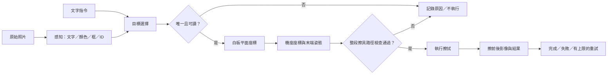

# 有據可查的選擇性擦拭：參賽研究與準備稿

更新：**2026-10-26（Asia/Taipei）**。本稿整合研究方向、可驗證主張、展示腳本與準備工作；推薦方案尚待團隊採用，未代表已執行。本輪完成研究文件與來源核對，不啟動照片實驗、開發、模型下載或硬體操作。

## 目標與現況

主軸是 **「擦對指定字，保留其他字，並用前後證據說明結果」**。推薦以分段感知、目標選擇、幾何校正、檢查後控制與擦後驗證組成流程。器材與操作條件就緒後，可追求固定條件下的完整任務展示；當下仍可獨立準備企劃、資料設計、計分與分鏡，缺設備不等於研究停止。

| 狀態 | 目前能核對什麼 | 不能據此推定什麼 |
| --- | --- | --- |
| 已完成 | 應用程式 0.1.0；人工 fixture 的文字／顏色精確選取，輸出 `selected`、`no_match`、`ambiguous`、`invalid_input` | 不是從照片辨識文字，也沒有可執行動作 |
| 既有證據 | [2026-10-24 驗證紀錄](verification.json)：既有與全新隔離環境各通過 21 項測試 | 本輪沒有重跑；測試不證明實機或 Thor 相容 |
| 已知討論條件 | 約四人；可能有人持有 LeRobot 相關設備 | 型號、校正、可操作狀態、工時與到場能力未知；LeRobot 不是特定手臂型號 |
| 待驗證 | OCR／真實感知、自然語言、相機、幾何校正、路徑與控制、擦後量測 | 沒有 Thor／ARM64／JetPack 執行證據，未完成競賽任務 |

**可放入企劃的短摘要：** 本專案擬研究依文字與顏色指定白板目標的選擇性擦拭，規劃將影像感知、目標決策、板面與機座校正、擦具路徑檢查及前後影像驗證串接，呈現選對目標、保留鄰字與可量測的擦後結果。已完成人工標記資料的離線選取器與診斷；後續擬以實拍案例建立逐例證據，再依設備與授權條件完成實機展示。若手臂未就緒，先交付照片到可重播選擇證據，並清楚標示尚未連接手臂。

官方目前公布書面選拔 15 隊，但選拔權重仍未知；以上是研究價值與證據安排，不保證得分或入選。[官方公告](https://www.surveycake.com/s/N99KD)與待確認事項另見[競賽資訊](competition.md)。

## 三個候選方向與推薦

| 候選 | 想交付的結果 | 本稿建議與原因 |
| --- | --- | --- |
| 完整有證據擦拭 | 指令到選取、動作與擦後比較，固定條件可重複 | **條件式推薦**。最直接對應任務；須先取得設備、校正與接觸證據 |
| 照片與決策證據 | 原圖、文字／顏色／框、選取理由與逐例結果可重播 | **備案**。沒有手臂也能完成，後續實作仍須另授權；若真實照片 OCR 未完成，降為人工標記 fixture 加明示設計稿 |
| 先訓練 VLA 展示 | 用語言、影像與示範動作學習策略 | **不作本輪主線**。資料、設備與時間未確認，尚無本任務證據；保留後續局部動作研究可能 |

選分段方案是為了讓失敗能定位與量測，不表示幾何方法必然優於 VLA。ACT 原論文不是語言條件策略；LeRobot 是跨硬體、資料與策略生態。公告尚未明確要求學習或模擬，不應由專案名稱或 sim-to-real 用語推導強制技術。

後續若比較感知或動作方法，先固定同一問題、輸入、案例與計分，再比較改善發生在哪一段，以及新增的資料、操作與整合成本。不能把一個方法的最佳剪影片，與另一個方法的全部嘗試比較。只有本任務證據顯示值得投入，才建議加深模型或模擬研究；本輪不預選套件、模型版本或訓練資源。

## 三項可驗證主張

| 主張 | 現有證據 | 要補的證據與判讀 |
| --- | --- | --- |
| 選對指定目標 | fixture 唯一精確比對、無符合、歧義與無效輸入診斷 | 真實照片加固定指令的正確、錯選與拒答，保留全部題數；全拒答不能當成功 |
| 保留其他字 | 尚無物理證據 | 鄰字位置、整段擦具覆蓋、定位誤差及擦後非目標損失；中心落對仍可能誤擦 |
| 擦後結果可量測 | 尚無擦前後資料 | 對齊的前後影像、目標殘留、鄰字損失、時間與介入；辨識不到不等於擦乾淨 |

三項共同報告成功與失敗。歧義拒絕能說明決策可追蹤，但不能代替可唯一回答題的正確選取，更不能代替擦拭完成。

## 候選架構與接口

**只有目標選擇的 fixture 版本已完成。** 文字輸入，以及英文紅色／藍色 `apple`，都是工作假設，並非官方指令、語言或板面規則；語音若必要，另增加輸入與誤差契約。

| 接口 | 規劃應交代的內容 |
| --- | --- |
| 原圖 → 感知 | 原圖 ID、尺寸、拍攝條件；每詞的 `text`、`color`、`bbox`、穩定目標 ID、可讀性與不確定原因 |
| 感知 → 選擇 | 保留辨識結果與人工答案的差異；真實資料另訂契約，不冒用現有 `fixture: true` |
| 選擇 → 白板 | 影像座標 px 轉板面公制座標，候選為 mm；保留轉換版本、參考點與誤差 |
| 白板 → 控制 | 板面到機座外參、工具尺寸、末端姿態與接觸設定；機座單位候選為 m，具體契約待定 |
| 控制 → 回饋 | 路徑、執行狀態、前後影像、介入與重試次數，共用案例 ID |

Homography 只處理平面映射；機座外參、末端落點、接觸、可達性仍須分別驗證。px、mm 與 m 不可混用，感知框也不能直接當馬達指令。進入控制前檢查**整段路徑的擦具覆蓋範圍**、鄰字距離、校正與定位誤差、工作區與可達性，不只檢查框中心。畫質未知不能歸為 `no_match`；失敗應保留原因，重拍或重試次數在實驗前訂上限，避免無限重試掩蓋問題。

## 展示故事與約 90 秒素材分鏡

核心場景放紅色 `apple`、藍色 `apple` 與鄰字。先指定紅色 `apple`，說明選擇理由，再以擦前後證據檢查其他字是否保留。另放同色同字重複與畫質不足案例，呈現歧義與感知失敗；這是可追蹤案例，不宣稱官方允許人工澄清。實機段須等後續授權與器材條件。本晚只完成腳本，不製作影片；90 秒為內部素材建議，非官方限時。

| 秒數 | 畫面與旁白重點 | 備案替換鏡頭 |
| --- | --- | --- |
| 0–12 | 白板全景與指令：「擦掉紅色 apple，留下其他字」；說明固定測試條件 | 相同場景的原圖，標明照片示範 |
| 12–30 | 疊觀察框、目標 ID、文字顏色與選擇理由；區分人工答案與系統輸出 | 照片與可重播 trace；人工標記必須明示 |
| 30–53 | 顯示路徑檢查後的一次連續執行，附案例 ID 與介入狀態 | 照片到選擇結果，標「尚未連接手臂」；無 OCR 時改標 fixture／設計稿 |
| 53–73 | 前後對照、目標殘留與鄰字變化；附本輪全部嘗試分母，不能只報這次成功 | 展示逐例選取表，擦後指標標尚未量測 |
| 73–90 | 同色重複、低畫質案例，交代拒答原因、限制與下一步 | 同一失敗表與待補證據，不以概念動畫充當執行 |

保留原片與所有嘗試，展示選樣另列。人工標記、概念動畫、遙操作與連續自動須各自標示，禁止剪接或人工擦除假充自動完成。重試、失敗與人工介入都留在紀錄中。

## 準備素材清單

ID 是未來整理依據；除明列可重用項外，全新素材均待製作，不表示已有檔案。

| ID | 內容與現況 | 可獨立準備／設備相依 |
| --- | --- | --- |
| M01 | 企劃摘要與三主張：本稿已有研究草案，投稿格式待確認 | 可獨立整理 |
| M02 | 架構、接口與風險：本稿已有候選設計，待團隊採用 | 可獨立覆核 |
| M03 | fixture 證據：既有 README、fixture、驗證紀錄可重用，限定 0.1.0 能力 | 不需手臂 |
| M04 | 首輪 8 張原圖、標註與第二人覆核：待製作 | 白板、筆、可用相機或手機 |
| M05 | 每案例指令、輸出、錯誤與計分表：格式規劃中，結果待製作 | 感知結果；fixture 可先獨立準備 |
| M06 | 控制原片、路徑與操作紀錄：待製作 | 已授權手臂、擦具、相機與操作場地 |
| M07 | 擦前後對齊影像與殘留／誤擦量測：待製作 | 同案例的實際擦拭、固定拍攝條件 |
| M08 | 分鏡與完整結果摘要：本稿有腳本，影片未製作 | 備案可用照片／trace；完整片需 M06–07 |

## 最小測試設計

沿用[10/24 原稿的 8 張設計](proposal-discussion.md)：3 張清楚正面，2 張分別同字異色與同字同色重複，1 張空白帶淡殘跡，1 張反光或陰影，1 張傾角或小字。這是診斷起點而非上限。固定指令須覆蓋唯一目標、同字異色、同色重複、不存在及低畫質；近鄰與擦後殘字另設物理案例，未操作前只列設計。

原圖記錄尺寸、書寫者、版面、條件與可讀性；逐詞標文字、顏色、框與 ID，由另一人覆核分歧。若擴充並調整方法，以書寫者與版面分組，先切開開發與保留集；同板重拍留在同組，避免調整過的版面又出現在測試。核心案例的重複次數可由團隊採用前固定，本稿不杜撰成功百分比或毫米承諾。

| 層級 | 預先固定的計分與分母 |
| --- | --- |
| 讀字與辨色 | 詞採 exact match；可讀詞為分母，拒答另列；各色混淆表保留錯色與未知 |
| 框與位置 | 框配對規則、門檻與一對一關係在看結果前固定；報漏檢、多檢與配對位置誤差 px |
| 指令選取 | 報照片數及指令題數；在全部可唯一回答題中列正確、錯選、拒答；不存在、歧義與畫質不足分開核對 |
| 校正 | 用未參與校正的 held-out 點量測板面誤差 mm；另量末端實際落點，不將平面誤差當工具精度 |
| 實際擦拭 | 同案例的目標殘留、非目標損失、總時間、介入及重試；統計全部嘗試與未完成原因 |

殘留與損失量測前，須固定對齊、曝光／光線與板面區域，避免拍攝變化被算成擦拭。可結合影像區域量測與人工覆核；OCR 不見字不能直接判定擦乾淨。完整結果表與影片選樣分開，少樣本結論限於該條件；若第一輪失敗，按讀字、辨色、定位、決策、校正、接觸或回饋分類再決定補哪種證據。

可操作的起點是：對齊後，在固定目標區域報「擦後殘留墨跡／擦前原墨跡」，在固定非目標區域報「被移除墨跡／擦前原墨跡」。墨跡量可用預先固定分割方式的像素面積，或改用人工覆核的有序等級。原區域沒有墨跡、無法對齊或判讀不可靠時標「不可評」，不給假零；通過門檻須依實際板擦、字距與量測方式在試驗前訂定，不能只憑 OCR 消失判通過。

每個案例應能從結果追回原圖、人工答案、指令與使用的方法設定。資料缺失與執行失敗都保留，不補寫成成功；照片證據、離線選取、校正量測與實際擦拭各自標明完成狀態，避免把其中一段通過寫成端到端完成。

## 四人候選分工與節點

以下是提案，尚無人員或工時承諾。每項一人主責、一人覆核；設備持有人不自動擔任 D。四人須共用案例 ID、同一批資料與計分規則，至少共同走完一次跨段案例。

| 代稱 | 主責候選 | 覆核候選 | 可投入時數／確認日 |
| --- | --- | --- | --- |
| A | 企劃、規則、整合與宣稱 | D | 待填／待填 |
| B | 原圖、標註、條件與資料品質 | C | 待填／待填 |
| C | 感知、逐例計分與失敗分析 | B | 待填／待填 |
| D | 手臂、幾何、擦具與控制可行性 | A，量測與 C 交叉核對 | 待填／待填 |

| 日期提案（2026） | 到時留下什麼 | 相依與分流 |
| --- | --- | --- |
| 10/26–28 | 團隊盤點、書面材料與測試規格 | 可獨立準備，不等手臂 |
| 10/29 | 說明會後核對規則、評分與投稿附件 | 官方公告為 18:00–19:00 |
| 10/30–11/02 | 若另獲授權，做首輪證據並選完整展示或備案 | 11/02 是建議分流點，可由團隊調整 |
| 11/03–05 | 依所選方向整合，或加深視覺與逐例證據 | 手臂未就緒不拖住書面稿 |
| 11/06–07 | 宣稱、附件與完整結果定稿，保留緩衝 | 未完成項清楚標示 |
| 11/08 | 依正式入口與格式提交 | 不自動報名或送件 |

日期是準備規劃，沒有建立排程或承諾本輪開發。入選後的設備操作與到場安排另確認，不由這份稿自動啟動。

## 未知、風險與需要團隊決定的分支

此表集中決策入口，不需要現在即時回覆。團隊填入負責確認者與決策日後，再把受阻部分排進計畫；可獨立的書面工作繼續。

| 未知／風險 | 影響的決策 | 目前推薦的預設分支 |
| --- | --- | --- |
| 手臂型號、校正與就緒狀態？已有 teleop／record 流程？ | 是否能合理追求連續實機展示 | 未確認前以照片證據為備案；關節校正不等於相機、機座或接觸校正 |
| 相機可用？可否加標記或固定治具？ | 感知與板面映射是否可重複 | 先訂拍攝條件與標註；未確認規則前不承諾標記方案 |
| 擦具尺寸、板面位置／幾何、接觸與摩擦？ | 鄰字距離、覆蓋與誤擦風險 | 先畫幾何與風險，不把選取框當可擦區 |
| 各人可用 hours、共同時段及到場能力？ | 完整或備案的投入深度 | 工時留空，約四人不換算人時；書面與資料設計先行 |
| 是否強制 VLA、學習或模擬？ | 技術方案是否需調整 | 暫以分段方案，規則公布後再決定，不先訓練 |
| 語音、離線、API／網路限制？ | 輸入與執行環境 | 文字為工作假設；不預設外部服務可用 |
| 投稿格式、頁數、附件、影片或原型要求？ | 最終包裝與可宣稱範圍 | 先備摘要、架構、證據與腳本，正式格式待核對 |
| 近鄰誤擦、殘字與畫質漂移？ | 是否值得追加動作或重試 | 保留負例；結果不佳時回查分段原因，不以挑片或無限重試補救 |

需要團隊採用的核心決定是：展示主張、完整／備案分支、四人主責覆核與可投入時間。尚無必要立即回答設備細節才能完成本稿；只有依賴該設備的執行與承諾受阻。

## 原始來源與查核範圍

查核日期皆為 **2026-10-26（Asia/Taipei）**。下列來源支持方法與規劃邊界，不代表本專案已重現論文或通過設備驗收；文件網址中的版本也不是依賴採用決定。

| 原始來源 | 支持的判讀 | 不支持的宣稱 |
| --- | --- | --- |
| [主辦官方公告／通知登記表](https://www.surveycake.com/s/N99KD) | 書面選拔、公布設備與日期；目前正式入口及評分仍待公開 | 不支持保證得分、必用 VLA／模擬或已完成報名 |
| [LeRobot 官方文件](https://huggingface.co/docs/lerobot/index) | 涵蓋硬體、資料收集與策略的生態 | 不能由「有 LeRobot」推定型號、就緒或擦拭能力 |
| [SO-101 官方文件](https://huggingface.co/docs/lerobot/en/so101) | 設備設定與關節校正有各自步驟 | 不能推定相機外參、板面、機座與接觸均校正完成 |
| [OpenCV calib3d／findHomography](https://docs.opencv.org/4.13.0/d9/d0c/group__calib3d.html) | 平面間的透視映射可作候選板面轉換 | 不保證末端落點、接觸、可達性或整段路徑安全 |
| [ACT 原論文](https://arxiv.org/html/2304.13705v1) | 以動作分塊處理示範學習，可作後續局部動作候選 | 原論文非語言條件；不能直接宣稱符合本任務 |
| [SmolVLA 論文](https://arxiv.org/html/2506.01844v1) | 語言／影像／動作策略及其訓練、評估設計可供研究 | 結果不可外推為白板擦拭證據，仍需本任務資料與驗證 |
| [Hugging Face SmolVLA 說明](https://huggingface.co/blog/smolvla) | 補充模型、資料與使用脈絡 | 不構成模型選定、下載授權或 Thor 相容證明 |

本稿保留[10/24 討論原稿](proposal-discussion.md)與其 [HTML 歷史版本](proposal-discussion.html)，不改寫其當時狀態；最新研究與準備方向以本稿為入口。
