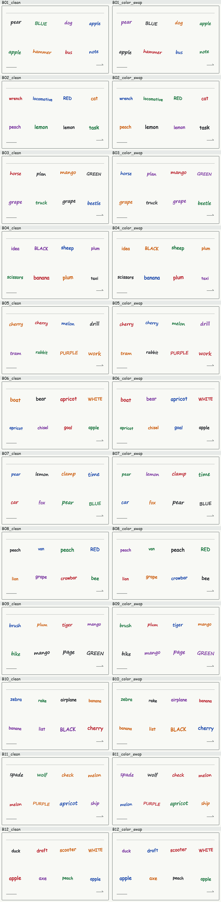

# 程式合成白板資料小型試辦（2026-10-30）

本資料包已用 **Python／Pillow 產生 12 組配對場景、24 張圖與 144 題繁體中文指令**，並核對標註完整性與同 seed 重播。它是 `development_pilot`，用於確認可重播的資料流程；沒有訓練、OCR／VLM 推論、機械手臂操作或資料增強成效結果。

24 張圖是 12 個 base board family 各自的 `clean` 與 `color_swap`，**不是 24 個獨立場景**。同 family 的兩張圖共用所有文字、版面、字型與 occurrence masks，僅把墨色依固定循環交換；未來劃分 train／validation／test 時，整個 family 必須放在同一側。這批已被開發者檢視，不可再稱為未見測試集。



## 資料是真實的什麼

圖片是 **font-rendered synthetic（字型渲染的合成圖）**，不是白板照片、真人手寫或模型生成影像。英文字由本機已安裝的 Segoe Print／Comic Sans MS 字型渲染；不能把手寫風格字型稱為手寫資料。背景、邊框、線條與箭頭也由程式繪製。每個 occurrence 的最終旋轉／縮放 mask 先固定，再合成影像；GT 框直接由該 mask 的實際非零範圍計算。

程式、有限詞表與指令模板由開發助手協助編寫，屬明確的規則設計，尚未經使用者驗收；執行時沒有呼叫 ChatGPT、其他語言模型、影像生成 API 或外部推論服務來生成圖片或答案。答案是程式規則計算，標記為 `programmatic_rule_ground_truth_not_human_annotation`，沒有偽稱人工標註或模型評分。

每個 family 有 8 個文字 occurrences，包含一個字義色與墨色衝突的色詞、兩次同詞出現，以及有限詞表中的水果／動物／工具／交通工具／昆蟲等文字；不是每張圖都具有所有類別。兩個 variants 都保留色詞與墨色衝突。12 個 family 使用不同詞彙與洗牌版面；交替使用兩個字型，並改變字級與小角度旋轉。沒有加入透視、模糊、反光、遮擋或相機噪聲。

## 題目與 GT

每張圖各有 6 題，每題都從原圖獨立選取；擦除意義只表示應選取哪些文字，不表示產生擦除後照片或物理動作。

| 題目 | 規則 | 配對後的預期 |
| --- | --- | --- |
| Q1 | 精確指定文字，如「只擦掉文字 BLUE」；不按字義推斷墨色 | 答案不變 |
| Q2 | 擦掉所有紅色墨水文字，以實際渲染墨色判斷 | 答案改變 |
| Q3 | 兩個同詞中選最左邊的 occurrence | 答案不變 |
| Q4 | 選取完整位於唯一錨點文字上方的單字 | 答案不變 |
| Q5 | 選取有限詞表的一類名稱；包含類別有出現及不存在的題目 | 答案不變 |
| Q6 | 保留動物或水果名稱，擦掉其他文字 | 答案不變 |

三類各 48 題：`exact_color`、`spatial`、`semantic`。本輪共有 120 題 `selected`、24 題 `no_match`；144 是影像／題目配對數，不是獨立場景數。

目視／設計複核後做了兩個局部修正：B03 的 `pliers` 改成 `beetle`，讓該圖 Q5「工具名稱」為 `no_match`；B08 的 `step` 改成 `bee`，讓該圖 Q5「昆蟲名稱」為 `selected`。如此避免所有昆蟲題都沒有答案、其他語意類別都有答案的簡單捷徑。昆蟲也屬動物，因此詞表採可重疊的多重標籤，整個 `insect` 詞表同時納入 `animal`，B03 Q6「保留所有動物名稱」也會保留 `beetle`。這仍是小型有限詞表的局部涵蓋，不代表完整類別平衡。修正前後皆是 120／24；這只是生成版本與資料完整性的紀錄，從未產生模型結果。

Q4 的「完全位於上方」定義為待選框的 `y_max < anchor.y_min`。Q3 依文字框中心 x 選最左，且重複詞固定在不同欄。`supervision/scenes` 中的像素框為 `[x_min,y_min,x_max,y_max]`，右／下界不包含在框內（Pillow half-open convention）；模型 reference answer 則依既有 VLM 契約轉成 0–1000 相對座標，保留 3 位小數。每次重複出現都有獨立 ID 與 mask。

語意 GT 只按 [有限詞表](source/lexicon.json) 計算，並不是語言模型做開放式理解或詞義消歧；本輪避開 orange／date／kiwi 等容易跨本資料類別的詞。其他英文詞仍可能有動詞或引申義，這裡只使用明列的名詞類別作開發規則，不宣稱有唯一的開放世界語意。未來若擴充語意題，需另檢查語境及人工答案一致性。

## 輸入與標註分離

- [model_inputs/index.jsonl](generated/model_inputs/index.jsonl) 只有題目 ID、圖片路徑與單題 prompt 路徑。真正餵給模型的內容只能是該張圖片及該題 prompt。
- `generated/model_inputs/prompts/*.txt` 沿用原照片比較的 VLM contract prefix，只替換末尾單題題目；沒有 scene、mask、GT、候選 ID 或正確框。
- [ground-truth.json](generated/supervision/ground-truth.json) 保存規則、應擦／應保留 ID 及 reference JSON answer；`supervision/scenes` 保存文字與框等私有標註；`supervision/masks` 保存 96 個獨立 occurrence masks（每組配對共用）。**以上不得作為模型輸入。**
- [pairs.json](generated/supervision/pairs.json) 綁定 12 組配對、mask IDs、預期不變／改變題目。
- [dataset-manifest.json](generated/dataset-manifest.json) 保存 seed、來源／程式／字型 SHA256、渲染環境及每項產物 SHA256。manifest 也不是模型輸入。

範例 B01：畫面中 `BLUE` 使用綠墨，兩次 `apple` 分別位於右上與左下。Q1 應選 `BLUE`，Q2 應選紅墨 `bus`，Q3 應選左下的 `apple`。交換墨色後 Q1／Q3 仍相同，Q2 會改選 `hammer`。這些只是規則 GT，尚無模型回答可比較。

## 重播與驗證

在 repo 根目錄、使用已存在且含 Pillow 的 Python 執行（本輪沒有安裝套件）：

```powershell
& '.cache/non-china-comparison/modern/Scripts/python.exe' -B 'experiments/synthetic-board-pilot-20261030/generate.py'
& '.cache/non-china-comparison/modern/Scripts/python.exe' -B 'experiments/synthetic-board-pilot-20261030/verify.py'
```

這是當前 Windows 的已驗證執行位置，並非可攜式環境安裝契約。也可用其他現成 Python 3.12／Pillow 環境執行，但須先核對字型檔、版本與 SHA；本程式不下載字型、不切換字型 fallback，字型缺少即停止。輸出只能寫入本 pilot 目錄，且不覆寫含有陌生檔案的輸出目錄。重播會更新 `generated` 中的本次已知產物；不會改舊三張照片／18 題。

已驗證環境：Windows 11（10.0.26200）、Python 3.12.14、Pillow 12.0.0。字型由 `C:/Windows/Fonts` 唯讀載入，字型檔沒有複製進資料包。來源與授權資訊位置列在 [spec.json](source/spec.json) 及 manifest，使用者應依所用系統／字型確認適用條件；本資料包沒有授予字型再散布權。這裡保存的是位置及雜湊，不宣稱已做法律或授權審查。

[verification.json](verification.json) 記錄本輪直接檢查結果 `passed`：

- 24 張圖、144 題、96 個非空 masks；192 次影像 occurrence 的框皆等於實際最終 mask bbox，沒有越界或相互重疊。
- 從影像的全不透明墨跡像素獨立核對顏色；另一路規則實作核對 144 題文字／顏色／位置／有限詞表答案與保留補集，沒有只重跑同一個選擇函式。
- 核對 `insect` 是 `animal` 的子集合，且 B03 Q6 保留 `beetle`；B03 工具題沒有答案而 B08 昆蟲題會選 `bee`。
- 144 個單題 prompt 完整且沒有 supervision；原 VLM prefix 保持一致。
- 12 組配對具有相同文字／框／masks；影像差異只在文字 mask 內；12 組 Q2 答案改變，60 組其餘題目答案不變。
- 293 個產物 SHA256 一致；在記憶體內以同 seed 重播，含 manifest 的 294 個檔案 bytes 全部一致。

已用圖片檢視工具閱讀整張 contact sheet 及 B01 原尺寸圖片；語意涵蓋修正並重播後，又核對新 contact sheet 與 B03／B08 原尺寸圖片，確認 `beetle`／`bee` 可見且沒有裁切或重疊。沒有以產檔成功代替圖片檢查。未做使用者人工驗收。byte 重現性僅對本次來源、字型 bytes、Python／Pillow／平台組合成立；未驗證其他 OS、版本或字型替換。

## 能與不能據此推論

目前可以確認程式能便宜地產生已知文字、墨色、版面、mask 與 GT，並能做同版面顏色干預的資料完整性檢查。這些是資料流程證據。

目前沒有新模型結果、訓練、5090 GPU 工作或國網工作；CPU 圖片生成不需要這些資源。此資料包不代表合成資料可改善真實白板、模型泛化、擦除正確率或物理擦拭成效。只有兩個字型、規則格狀版面與有限英文詞表，與真人手寫／相機照片仍有明顯落差。若後續決定測試資料增強效果，需以另行採集且未被調整用過的真實照片驗證，並將同 family 變體放在同一 split；本輪不啟動該階段。
